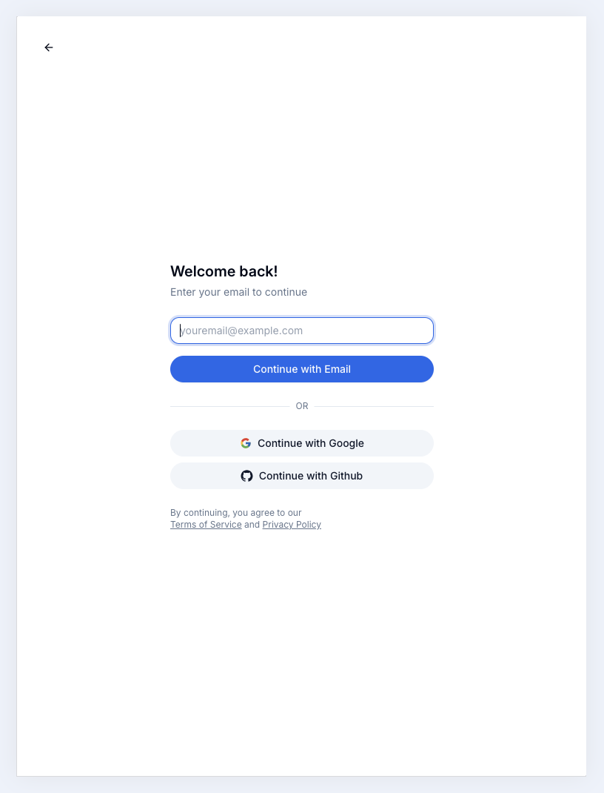
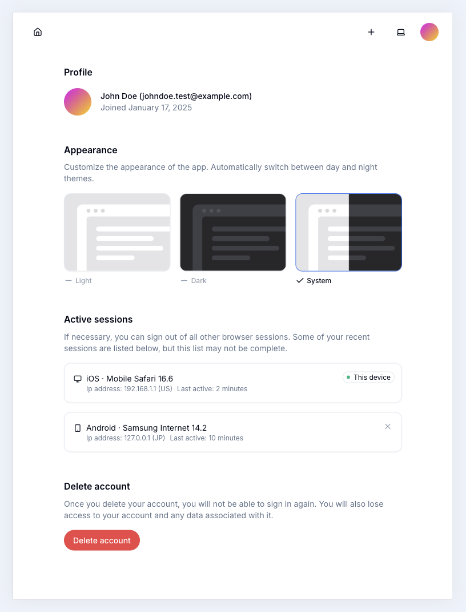

# React Router v7 with Remix Auth Starter Kit

An introductory starter kit for building applications with React Router v7 (Remix) and Remix Auth, designed to run seamlessly on Cloudflare Workers.

## Features

- 🔐 **TOTP, Google, and GitHub Login**  
  Supports TOTP authentication, Google login, and GitHub login. TOTP is integrated with Resend for secure email-based verification.

- 🔑 **KV-Based Authentication and Rate Limiting**  
  Efficient session management and rate limiting using Cloudflare KV.

- 🛢️ **Drizzle ORM + Cloudflare D1**  
  Seamless database integration with Drizzle ORM and Cloudflare D1.

- 🌗 **Dynamic Color Schemes**  
  Supports theme customization with color scheme switching.

- 🎨 **TailwindCSS + Shadcn UI**  
  Modern and customizable UI styling with TailwindCSS and Shadcn components.

- 🧪 **Biome.js for Code Quality**  
  Ensures high-quality code with integrated linting and formatting.

- 🚀 **Cloudflare Workers-Ready**  
  Optimized for deployment on Cloudflare Workers.

## Demo

Here's a preview of the app:

<div style="display: flex;">
  
  
</div>

For more demo images, check the **.assets** directory.


## Links

More from the React Router v7 Series:
- [React Router v7 with Better Auth](https://github.com/foxlau/react-router-v7-better-auth) - Authentication demo using Better Auth package.
- [React Router v7 Cloudflare workers template](https://github.com/foxlau/react-router-v7-cloudflare-workers) - React Router v7 Cloudflare workers template.

## Getting Started

### Prerequisites

- [Bun](https://bun.sh/) 1.4.2 (the version pinned in `package.json`)
- Node.js 24 LTS for the React Router and Cloudflare tooling

Bun manages dependencies and scripts; the application still runs on Cloudflare Workers.

### Installation

Git clone the repository:

```bash
git clone https://github.com/foxlau/react-router-v7-remix-auth.git
```

Enter the project, prepare the local Wrangler configuration, and install the dependencies:

```bash
cd react-router-v7-remix-auth
cp wrangler.jsonc.example wrangler.jsonc
bun install
```

Update `wrangler.jsonc` with your Cloudflare resource settings before deploying. Commit `bun.lock` when updating dependencies; CI installs with `bun install --frozen-lockfile`.

### Development

First, copy the .dev.vars.example file and rename it to .dev.vars:

```bash
cp .dev.vars.example .dev.vars
```

Update the environment variables in the .dev.vars file according to your needs. These variables will be used by Wrangler during local development.

Run an initial database migration:

```bash
bun run db:apply
```

If you modify the Drizzle ORM schema, please run `bun run db:generate` first. If you need to delete the generated SQL migrations, execute `bun run db:drop` and select the SQL migration you wish to remove.

Start the development server with HMR:

```bash
bun run dev
```

Your application will be available at `http://localhost:5173`.

## Building for Production

Create a production build:

```bash
bun run build
```

## Deployment

Deployment is done using the Wrangler CLI.

```bash
bunx --no-install wrangler d1 create rr7-remix-auth
bunx --no-install wrangler kv namespace create APP_KV
```

To deploy directly to production:

```sh
bun run db:apply-prod
bun run deploy
```

To deploy a preview URL:

```sh
bun run deploy:version
```

You can then promote a version to production after verification or roll it out progressively.

```sh
bun run deploy:promote
```

## Dependency updates and auto-merge

Dependabot checks Bun dependencies and GitHub Actions weekly. Minor and patch updates are grouped per ecosystem. The PR validation workflow enables squash auto-merge only for Dependabot minor/patch PRs after lint, type checking, and the production build pass. Major updates require manual review. Major migrations for React Router, Remix Utils, TypeScript, and Node types are intentionally excluded from routine PRs while this starter targets React Router v7, TypeScript 6, and Node 24 LTS; initiate those migrations manually.

To enable this on GitHub:
1. In **Settings → General → Pull Requests**, enable **Allow auto-merge** and **Allow squash merging**.
2. Protect `main` and require the **⬣ Biome lint** and **🔎 Type check** checks (the latter also runs the production build). The existing check names are preserved.
3. Keep **Settings → Actions → General → Workflow permissions** set to **Read repository contents and packages permissions**. Leave **Allow GitHub Actions to create and approve pull requests** disabled. Only the isolated merge job requests `contents: write` and `pull-requests: write`; no personal access token, repository-wide default write permissions, or automatic approval is needed. Any required human approvals still apply.

The repository-level merge settings can also be enabled with GitHub CLI:

```bash
gh repo edit foxlau/react-router-v7-remix-auth --enable-auto-merge --enable-squash-merge
```

The workflow and Dependabot configuration must be committed and merged into the default branch before the automation is active.

For this public repository, only PRs authored **and triggered** by the official `dependabot[bot]` account (GitHub user ID `49699333`) can enter the write-enabled merge job. The PR must come from a `dependabot/` branch in this repository, target `main`, and not be a draft. Fork PRs, other authors/actors, and human-triggered re-runs cannot trigger automatic merging. PR validation jobs retain read-only permissions; PR-merging permissions are confined to the isolated merge job. It never checks out PR code, keeps Dependabot's author/commit verification enabled, and checks the PR head commit before merging. The workflow uses `pull_request`, not `pull_request_target`.

**Allow auto-merge** is a repository-wide GitHub feature, not an author allowlist. This workflow only enables it for Dependabot; maintainers with sufficient repository permissions can still enable it manually on other PRs. External contributors do not gain merge permissions just because the repository is public.

If the repository uses a merge queue, a suitably scoped GitHub App token or personal access token is required instead of `GITHUB_TOKEN`.

### Security checks and dependency graph

Run `bun run audit` locally. Dependency auditing is also part of required PR validation, and `.github/workflows/dependency-security.yaml` rechecks the default branch weekly.

GitHub's native dependency graph does not currently parse `bun.lock`; Bun version-update PR support is separate from security-alert coverage. The default-branch security workflow submits the complete Bun dependency inventory using an immutable, reviewed revision of `pippinmole/bun-dependency-submission`. Only that default-branch submission job receives `contents: write`; it does not run on PRs, install dependencies, execute package scripts, approve PRs, or merge anything. Retire this community integration when first-party Bun dependency-graph support is available.

The `@esbuild-kit/esm-loader` override replaces Drizzle Kit's deprecated loader with its maintained successor, `tsx`, removing the vulnerable nested `esbuild` without forcing every consumer onto a different esbuild release. See [the upstream issue and workaround](https://github.com/drizzle-team/drizzle-orm/issues/4852). Remove the override when the maintained Drizzle Kit release no longer includes the deprecated loader; validate schema export and migration checks when changing it.

## Questions

If you have any questions, please open an issue.
